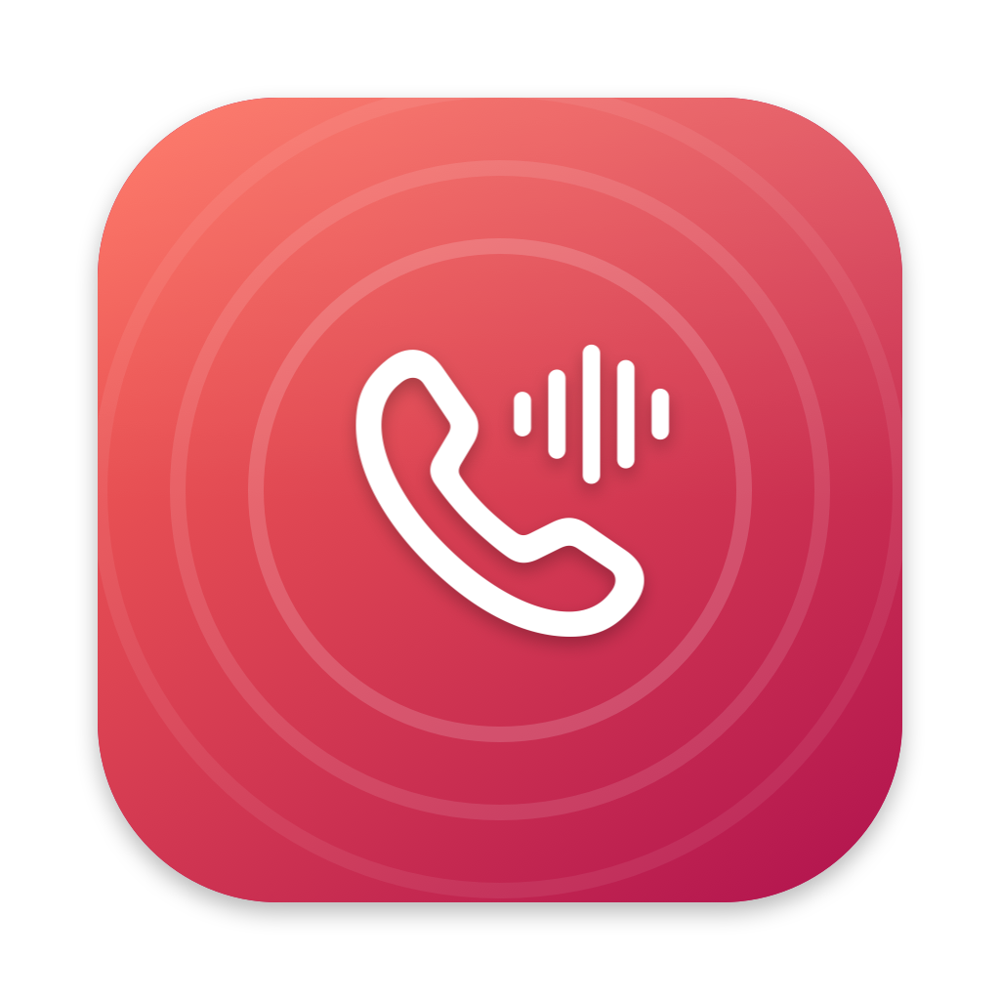

# CallTap

A macOS menu bar app that records calls and other audio on the Mac, and transcribes them on the
Mac itself.

- **Calls:** WhatsApp, FaceTime (including iPhone calls answered on the Mac), Zoom and Teams.
  When a call starts, a notification offers **Record**; the recording stops when the call ends.
- **Everything you hear:** all audio the Mac plays.
- **One app:** pick any app that is playing audio (a browser tab, Spotify…).
- **Your voice:** always included in calls; optional for the other two.
- **Audio devices:** pick the system's output and input, set their volume and mute them from the
  same panel — the same settings as System Settings › Sound — with a warning when the input is a
  headset microphone, and a level meter for each. The meters capture only while the panel is open
  (macOS shows its recording indicators meanwhile) and never open an idle headset microphone.
- **Transcription** (macOS 26+): a `.txt` next to the recording, with who spoke and when —
  `[01:23] Me: …` / `[01:25] Them: …`. Runs on-device; the language model downloads once.

Recordings are saved as `.m4a` in `~/Documents/CallTap Recordings`.

**Tell the other person you are recording.** Recording a conversation without consent is illegal
in many places.

## How it records

- **App audio** comes straight from the app's own output through a Core Audio process tap
  (macOS 14.2+), so it keeps full quality and nothing else is captured. "Everything" uses a global
  tap that excludes CallTap itself.
- **Your voice** comes from the microphone the call app is already using. Outside a call it is the
  default input — unless that is a Bluetooth microphone nobody has opened yet, in which case the
  Mac's built-in microphone. CallTap never opens a headset microphone on its own: that would force
  the headset into the hands-free profile and degrade the call.
- **Switching devices mid-recording** keeps one recording. The app audio does not depend on the
  output device. Your voice re-applies the microphone rule above every second — so it moves with
  the call app, or recovers if a microphone disappears — and every microphone is converted to one
  48 kHz track, with the moment of the switch filled with silence so your voice stays in step.
- Each source is written to its own temporary track, then mixed into one `.m4a`. If the mix fails,
  the raw tracks are kept next to where it would have been saved.
- **Interrupted recordings are recovered.** Each recording leaves a small manifest next to its
  temporary tracks; if the app dies mid-recording (crash, force quit, reinstall), the next launch
  finds tracks nobody has written to for 30 seconds and rebuilds them into
  "<title> (recovered) <date>.m4a", transcribed like any other.
- The tap is clocked by the built-in output, not by the headset: a Bluetooth headset drops to
  16 kHz as soon as any app opens its microphone, and a recording labelled with the wrong rate
  plays back sped up. `scripts/capture-selftest.sh` checks this with a test tone.

A call is detected while one of the call app's processes captures microphone input. Recording a
voice message looks the same from outside, so it also triggers the prompt. Detection for FaceTime,
Zoom and Teams relies on their bundle IDs and has not been checked on a live call.

### Call quality with Bluetooth headphones

Using a Bluetooth headset's microphone forces the hands-free profile, which degrades audio in both
directions — on any call, recorded or not. Choose the Mac's microphone as input (System Settings ›
Sound, or the call app's audio settings) and keep the headphones for listening. The menu warns when
the input is a Bluetooth one.

When recording everything with your voice through the Mac's speakers, the microphone also picks up
the speakers; use headphones.

## Permissions

macOS asks once for each: notifications, the microphone, **System Audio Recording** (without it the
tap records silence instead of failing) and, for transcription, speech recognition. Saving into
Documents may ask for folder access.

## Build and run

```bash
./scripts/build-app.sh --install    # builds and copies CallTap.app to ~/Applications
swift test                          # unit tests: naming, alignment, gap filling, app grouping, call
                                    # detection, transcripts, meter scale, recovery
./scripts/capture-selftest.sh       # records a 1 kHz tone through the capture code; pass "JBL" (or your
                                    # headset's name) to test with its microphone open, and a second
                                    # name to switch microphones halfway (e.g. MacBook JBL)
./scripts/make-icon.sh              # regenerates Resources/AppIcon.icns
```

The app is ad-hoc signed; each rebuild changes its signature, so macOS asks for the permissions
again after reinstalling.
